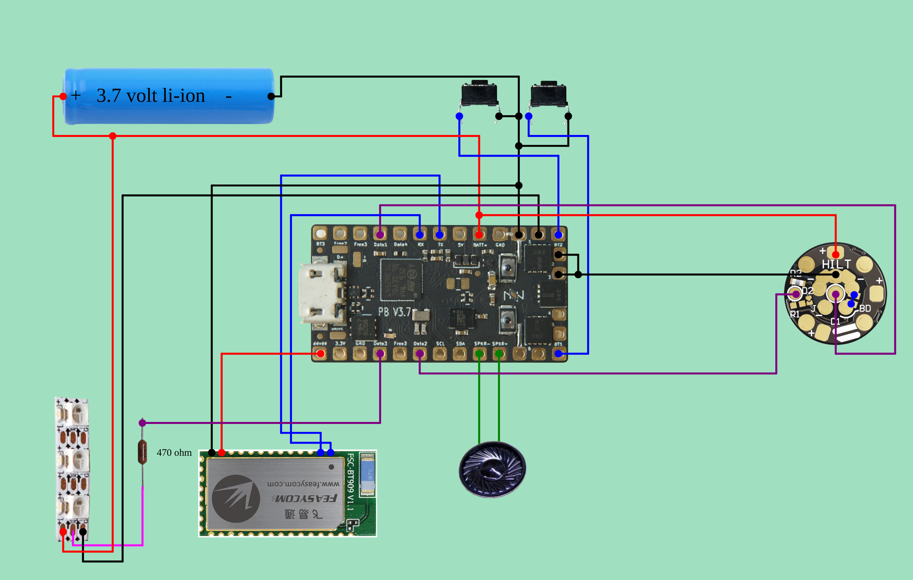
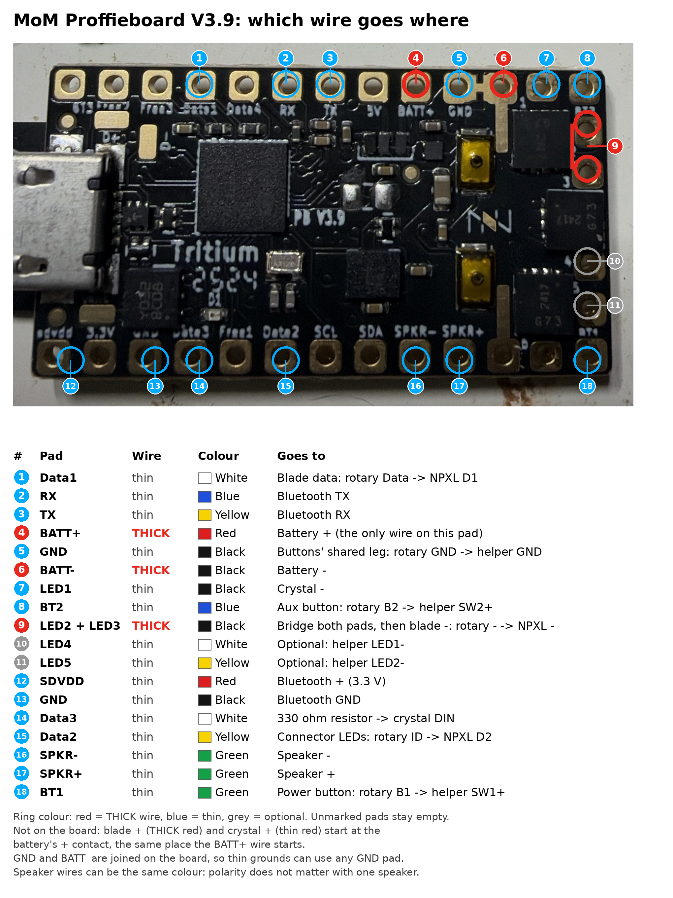

# MoM saber wiring (Proffieboard V3.9)

The diagram below comes from [Fredrik Hubbe's Proffieboard V3 configurator](https://fredrik.hubbe.net/lightsaber/v6/configurator.html). That page builds its diagram in JavaScript after you choose options, so `generate.js` loads it in headless Chromium, sets the form from `variants.json`, and saves what it draws. The pad tables are read from the configurator's own routing data, so they match the picture.

The configurator doesn't know about the Shtok rotary connector or the MoM helper board, so those sections come from Shtok's manuals, linked below.

## Parts for the MoM saber

| Part | What it does in this build |
| --- | --- |
| MoM hilt | The hilt |
| BRrogers crystal chamber | Lit by 2–4 LEDs cut from the WS2812 mini strip |
| MoM FX helper board (Veracity calls it v4.1) | Sits in the control box behind the green reveal board. Carries the two buttons (side-push switches pressed by the box buttons) and two plain LEDs. See "MoM FX helper board" below |
| Proffieboard V3.9 + SD card | Sound board. Yours is made by Tritium Sabers and printed "PB V3.9"; Hubbe's [V3 page](https://fredrik.hubbe.net/lightsaber/v6/) lists Tritium as a V3.9 maker. The diagram photo is a V3.7, and the configurator covers the whole V3 family (`proffieboard_v3_config.h`) |
| FSC-BT909 Bluetooth module (KR Sabers carrier board) | Bluetooth: 4 thin wires to SDVDD, GND, TX and RX. See "Bluetooth board" below |
| 28 mm 4 Ω 3 W bass speaker | SPKR+ / SPKR− |
| 18650 3120 mAh protected cell (1 of the 2) | Battery. Protected cells are a few mm longer than unprotected ones, so check it fits between the spring contacts |
| Spring battery contacts | Hold the battery; it comes out to charge |
| 2 A charger | External, shared with the Obi-Wan. There's no charge port in this build |
| Shtok Rotary NeoPixel & 2 Button PCB connector set (1 set) | Joins the removable chassis to the hilt. Carries power, blade data, connector-LED data and both buttons |
| Shtok NPXL V4 hilt-side connector + 1" holder | Where the blade plugs in. Has 16 LEDs of its own |
| 330 Ω 0603 resistor (surface-mount chip marked "331", on a paper strip; 0603 is 1.6 × 0.8 mm) | In series on the **crystal chamber** data wire (Data3). Tin both ends, solder the Data3 wire to one end and the crystal's DIN wire to the other, then cover it with heat shrink |
| WS2812 mini strip (cut 2–4 LEDs off) | Crystal chamber light |
| 4-pin SMT pogo connector | Not placed yet (see "Still to confirm") |
| Saberbay 1" thin-walled 36" neopixel blade | Main blade, 130 LEDs (Saberbay's formula: 36 ÷ 40 × 144 ≈ 130) |
| 1" aluminum hero NeoPixel blade plug + 4× 2 mm magnets | Goes in the blade holder when the blade is out. Saberbay's NeoPixel plugs come with their own blade-side LED board; that's the ring of gold contacts on top of yours. Lit by that board and the NPXL's 16 LEDs |
| Still needed | M3 × 8 mm countersunk screw, PTFE wire (stranded; see "Wiring the Proffieboard"), and the printed chassis (LEDO 6060 resin, from Jawa's Depot) |

## Order split: MoM vs Obi-Wan (Roman Elite Inception)

The Saber Armory order covers both sabers.

| Ordered | MoM | Obi-Wan | Shared or spare |
| --- | --- | --- | --- |
| Proffieboard v3.9 ×2 | 1 | 1 | |
| FSC-BT909 Bluetooth PCB Unit ×2 | 1 | 1 | |
| 28 mm 4 Ω 3 W speaker ×2 | 1 | 1 | |
| Rotary NeoPixel & 2 Button connector set ×2 | 1 | Not on the Obi-Wan list | The second set: the Obi-Wan's if its chassis comes apart, otherwise spare |
| Keeppower 18650 3120 mAh dual pack | 1 cell | | 1 spare cell |
| Keeppower 21700 5000 mAh | | 1 | |
| Spring Battery Contacts Set | ✓ | | |
| Battery Contacts Set (Keystone) | | ✓ | |
| NPXL V4 hilt side, short pins, assembled ×3 (17.5 mm) | 1 | 2 | |
| NPXL V3/V4 hilt-side holder 1" | ✓ | | |
| NPXL blade-side LED board (the round "BLADE" board with 5 LEDs) | | ✓ | Spare if the Obi-Wan's blade arrives with its board installed |
| 330 Ω 0603 SMD resistor ×2 | 1 | 1 | |
| WS2812 2020 mini strip, 10 LEDs | 2–4 LEDs | | The rest |
| KR 128x32 OLED, white | | ✓ | |
| High Amp Kill Switch (silver C&K slide switch, marked 3A 120VAC) | See "Still to confirm" | ✓ | |
| Battery and Speaker PCB Connector Set (20.00 mm per the listing) | | ✓ | |
| Low Profile Red Tactile Switch ×2 | | ✓ | |
| Replacement Pogo Pins, short ×4 (the 4 loose pins) | | | Shared spares. They fit the rotary, battery/speaker and short-pin NPXL boards |
| 2 A charger | | | Shared |

The battery and speaker set you ordered is the one The Saber Armory lists at **20.00 mm** for both boards. The 17.5 mm version is a separately named listing, and **20.5 mm** is the rotary set's size. Measure it to be sure.

Not from this order:
- **MoM:** hilt, crystal chamber, helper board, reveal board, Saberbay blade, hero plug and magnets, 4-pin pogo connector.
- **Obi-Wan:** the Roman Elite Inception hilt (static and vented pommels, blade plug) and its Saberbay blade.
- **Not on either list:** the mini black 3-pin slide switch. It's low-current only and must never go in a blade's power line.

## Configurator settings

| Configurator field | Setting |
| --- | --- |
| Blade 1 | **Illuminated PCB**, 130 LEDs, RGBW off, ZigZag off, Blade Detect **off** |
| Button 1 / Button 2 / Button 3 | Momentary / Momentary / None |
| Display | None |
| Charge Port | **off** |
| Blade 2 | None |
| Bluetooth | FSC-BT909 |
| Kill switch | off |
| Blade 3 | Neopixel crystal chamber, 4 LEDs |
| IR receiver, Reverse orientation | off |

"Illuminated PCB" is the configurator's option for a lit pogo connector like the NPXL V4. The board it draws has the same + / − / D1 / D2 / BD pads.

## Wiring diagram



## Wiring the Proffieboard: thick or thin



Use **thick** wire only where the blade's current flows: the battery in and out, and the blade's + and −. Everything else gets **thin** wire. Hubbe's [V3 page](https://fredrik.hubbe.net/lightsaber/v6/) says most pads carry almost no current and can use 30 AWG, but the battery wires carry the combined current of every LED. Shtok's NPXL manual asks for 20–22 AWG on the blade's + and −.

| Proffieboard pad | Wire | Runs to | Notes |
| --- | --- | --- | --- |
| **BATT+** | **Thick** | Battery + | The only wire on this pad. Goes through the helper board's BATT+ → BRD+ if check 2 says it's in the battery line |
| **BATT−** | **Thick** | Battery − | Every LED's current comes back through here |
| **LED2 + LED3** | **Thick** | Blade −: rotary **−** → NPXL **−** | The two pads are next to each other. Strip enough wire to lay across both and solder them together |
| **GND** | Thin | Shared leg of both buttons: rotary **GND** → helper **GND** | GND and BATT− are joined on the board, so any GND or BATT− pad works |
| **GND** | Thin | BT909 **GND** | |
| **Data1** | Thin | Rotary **Data** → NPXL **D1** (blade) | Data1 has a 470 Ω resistor built in, so no extra resistor |
| **Data2** | Thin | Rotary **ID** → NPXL **D2** (connector's 16 LEDs) | The NPXL has its own 330 Ω (R2) on D2 |
| **Data3** | Thin | **330 Ω resistor** → crystal **DIN** | Data2–4 have no built-in resistor. Slide heat shrink over the resistor |
| **LED1** | Thin | Crystal chamber **−** | |
| **BT1** | Thin | Rotary **B1** → helper **SW1+** (power) | |
| **BT2** | Thin | Rotary **B2** → helper **SW2+** (aux) | |
| **RX** | Thin | BT909 **TX** | TX and RX cross over |
| **TX** | Thin | BT909 **RX** | |
| **SDVDD** | Thin | BT909 **+ / VCC** | Switched 3.3 V |
| **SPKR+ / SPKR−** | Thin | Speaker | Under 1 A even at full volume (3 W into 4 Ω) |
| **LED4 / LED5** | Thin | Helper **LED1− / LED2−** | Optional, after check 3. Only works if the helper board is on the Proffieboard's side of the rotary connector, because the rotary has no spare contacts |

Two + wires don't go on the Proffieboard at all: **blade +** (thick, to rotary **+** → NPXL **+**) and **crystal +** (thin). Solder both at the **battery's + contact**. Shtok's rotary diagram feeds the blade + straight from the battery the same way, and it keeps the small BATT+ pad down to one wire.

Keep blade + on the battery side even if check 2 finds a switch between the helper's BATT+ and BRD+. Small slide switches like the ones in this order are rated around 3 A or less, and the blade can draw more than that. Wired this way, the switch only carries the board's own current. The blade still goes dark when the switch is off: blade − runs through the board's LED2/LED3 switches, and Hubbe's V3 page notes those have pull-down resistors that turn them off when the board has no power.

**Use stranded wire for the final install, not solid core.** Solid wire is stiff. It pries at the pads, and wires that bend repeatedly (removable chassis, battery swaps, clashes) tend to crack next to the solder joint. Silicone or PTFE stranded wire is the usual choice; Shtok pre-wires its NPXL connectors with PTFE, 22 AWG for + and −. The 22 AWG solid-core box is fine for a bench test. For the four thick wires in the saber, get about 1 m (3 ft) each of red and black 22 AWG stranded.

Colour plan for black, red, white, green, yellow and blue. Each group of wires that ends at the same part has no repeated colour, except the thick and thin black at the rotary connector, which you can tell apart by size. Flag each wire's far end with masking tape anyway.

| Ends at | Wires (Proffieboard pad → colour) |
| --- | --- |
| Rotary connector pin board | blade + **red thick** (from the battery + contact), LED2+LED3 **black thick**, GND black, Data1 white, Data2 yellow, BT1 green, BT2 blue |
| Battery contacts | BATT+ **red thick**, BATT− **black thick** |
| Bluetooth board | SDVDD red, GND black, TX yellow, RX blue |
| Crystal chamber | crystal + red (from the battery + contact), LED1 black, Data3 white (through the 330 Ω) |
| Speaker | SPKR+ and SPKR− both green. Polarity doesn't matter with one speaker |
| Helper LEDs (optional) | LED4 white, LED5 yellow |

Tips for long wires you'll trim later:

- **Length:** the chassis-side wires only need to reach the rotary connector's pin board (CHC_M), not the emitter. The hilt side gets its own short wires from the ring board (CHC_F). Cut each wire to reach the far end of the chassis plus about 5 cm (2"). If you can't measure yet, 20 cm (8") each is plenty.
- **Bench test first:** with the wires long, you can hook up the battery, speaker, buttons and blade connector on the bench, flash the config and test everything before trimming anything.
- Use red and black for the thick + and − wires.
- Give each thin wire a different colour and write down which colour is on which pad. Once the wires are trimmed and bundled, that list is the only way to tell them apart.
- Tin the pads and the wire ends before you join them.

On the crystal strip, use the end whose arrows point away from the wire (DIN), and connect the strip's 5V/+, DIN and GND/− pads.

## Bluetooth board (KR Sabers BT909 module PCB)

The BT909 is mounted on a KR Sabers carrier board, sold by The Saber Armory as the [FSC-BT909 Bluetooth PCB Unit](https://thesaberarmory.com/products/shtokcustomworx-fsc-bt909-bluetooth-pcb-unit). The pads are labeled on the back. The listing's [wiring image](https://cdn.shopify.com/s/files/1/0262/5368/8868/products/SCW-BT909-3.jpg) marks RX "to TX" and TX "to RX", so the data wires cross over, the same as the configurator draws.

| BT909 board pad | Proffieboard pad | Wire |
| --- | --- | --- |
| **+3.3V** | SDVDD | Thin |
| **GND** (the one next to +3.3V) | GND | Thin |
| **RX** | **TX** | Thin |
| **TX** | **RX** | Thin |
| Second **GND**, **LED 1**, **LED 2** | Leave empty | Only for optional external status LEDs. The board already has its own two |

SDVDD is a 3.3 V supply the Proffieboard can switch off in low-power mode, which is why the configurator uses it for Bluetooth.

## Shtok NPXL V4 hilt-side connector

From Shtok's [NPXL V4 manual](https://drive.google.com/file/d/1S0gRH6mnw8OvC6XNEBnWZGeY1ES1nhG6/view), the hilt-side board has these pads:

| NPXL pad | Wire to |
| --- | --- |
| **+** (positive pads) | BATT+ |
| **−** (negative pads) | LED2 + LED3 |
| **D1** | Data1 (blade) |
| **D2** | Data2 (the 16 on-board LEDs) |
| **BD** | Not used. Blade detect is off (see below) |

This is the manual's **Option 4**: blade and connector LEDs on separate data wires, which is also what the configurator draws. **Option 4 needs resistor R1 removed.** R1 is the tiny resistor next to D2, labeled R1 in the diagram. If R1 is still fitted, D1 and D2 are tied together through it, and two data outputs end up fighting each other. Leave R2 in place.

## Shtok rotary connector (Rotary NeoPixel & 2 Button set)

This is a pass-through. Every ring on the female board (CHC_F) touches the same-named pins on the male board (CHC_M), in any rotation. Following Shtok's [Proffieboard diagram](https://cdn.shopify.com/s/files/1/0262/5368/8868/products/image_90123a68-bfdd-4d91-a77c-03377dd314f2.png), the **pogo-pin board (CHC_M)** goes on the chassis side with the Proffieboard. The **ring board (CHC_F)** goes on the side with the buttons and the NPXL connector.

| Pad (same on both boards) | Chassis side: from the Proffieboard | Hilt side: to |
| --- | --- | --- |
| **+** | BATT+ | NPXL + |
| **−** | LED2 + LED3 | NPXL − |
| **Data** | Data1 | NPXL D1 |
| **ID** | Data2 | NPXL D2 (repurposed; see below) |
| **B1** | BT1 | Power button |
| **B2** | BT2 | Aux button |
| **GND** | BATT− | Other leg of both buttons |

This set has one data contact plus an **ID** contact. The blade and the connector LEDs need two data wires, so this wiring carries the connector-LED data (D2) on ID. That leaves no contact for the NPXL's blade-detect (BD) pin, which is why Blade Detect is off.

If the buttons don't actually pass through the rotary connector in the MoM hilt, B1 and B2 are free. You could then turn Blade Detect on and run BD to the Free1 pad.

## MoM FX helper board

Veracity calls this board **v4.1**. The "V1" and "V2" on the chassis page are the chassis designer's labels, and I found nothing that connects them to Veracity's version numbers. The designer describes V2 as having plain LEDs, which matches this board, but that doesn't confirm v4.1 is V2.

The board sits in the control box behind the green reveal board. The control-box buttons press its two side-mounted switches, per BRrogers's [assembly thread](https://www.therpf.com/forums/threads/fx-reveal-board-assembly-for-fx-mom-cave-hero.339167). I couldn't find a wiring guide for it, so this mapping comes from its printed labels. Run the checks below before soldering.

| Helper board pad | Proffieboard pad | How sure |
| --- | --- | --- |
| **SW1+** | BT1 (power button) | Likely. Signal side of switch SW1 |
| **SW2+** | BT2 (aux button) | Likely |
| **GND** | BATT− | Likely. Common for both switches |
| **BATT+** | Battery + | Likely |
| **BRD+** | BATT+ | Run check 2 |
| **LED1−** | LED4 | Run check 3. Negative of the board's plain LED1. R1 is probably its resistor |
| **LED2−** | LED5 | Run check 3. R2 is probably LED2's resistor |
| **DATA1 / DATA2** | Leave unconnected for now | Run check 4. Plain LEDs don't take data, so these do something else |

If the helper board is on the far side of the rotary connector, SW1+, SW2+ and GND go through its B1, B2 and GND rings.

Checks, using a multimeter in continuity (beep) mode with nothing connected:

1. **Buttons:** hold the top switch. **SW1+ ↔ GND** should beep only while it's pressed. Do the same with the second switch and **SW2+**.
2. **Power:** test **BATT+ ↔ BRD+**.
   - If it beeps, they're joined, probably through F1 as a fuse. Run battery + to BATT+, and BRD+ to the Proffieboard's BATT+.
   - If it doesn't beep, see whether BATT+ and BRD+ each beep to one of the three big **U$2** pads. If they do, U$2 is probably where the 3-pin slide switch (kill switch) goes.
3. **LEDs:** **LED1−** should beep to a pad of the white part marked LED1. **LED2−** should do the same with LED2.
4. **Data:** find out where **DATA1** and **DATA2** go. Test each one against the three **U$2** pads and the other parts on the board. They may just pass through to something else. Nothing in this build needs them: the blade, connector LEDs and crystal all have their own data wires.

Once the checks are done, LED1 and LED2 go into the config as two plain LEDs on LED4 and LED5. That adds two more blades, so every preset needs two more styles.

## Still to confirm

- **Helper board:** the four checks above, and whether Veracity's v4.1 is the chassis designer's V2.
- **Kill switch for the MoM:** the one High Amp Kill Switch in the order is counted for the Obi-Wan. Your notes say the MoM chassis routes a kill switch through the helper board's pogo pin 1, so the MoM may need a switch of its own. I haven't seen the chassis instructions. Send the Jawa's Depot page or its wiring notes and I'll map it, together with check 2 (the helper's BATT+, BRD+ and U$2 pads). Whatever switch goes in must not carry the blade current: keep blade + on the battery side as described above, or use Hubbe's [low-current switch method](https://fredrik.hubbe.net/lightsaber/v6/) (cut the BATT−/GND bridge and switch only the board). The mini black switch is only usable in a low-current spot like that. The configurator's own kill-switch drawing puts the switch in the main battery + line, which would carry the full blade current.
- **4-pin SMT pogo connector:** where it goes on the MoM. If the chassis uses it to join the helper board (pin 1 being the kill switch), the buttons might go through it instead of the rotary's B1/B2. That would free those two rotary contacts, for example for blade detect. The chassis instructions should settle this too.
- **Second rotary connector set:** not on either saber's list. It's the Obi-Wan's if its chassis comes apart, otherwise a spare.

## Config (`out/mom/config.h`)

```cpp
#define NUM_BLADES 4
#define NUM_BUTTONS 2
#define SHARED_POWER_PINS
#define ENABLE_SERIAL      // Bluetooth
...
WS281XBladePtr<130, bladePin, Color8::GRB, PowerPINS<bladePowerPin2, bladePowerPin3> >(),                                   // main blade
SubBladeWithStride(0, 15, 2, WS281XBladePtr<16, blade2Pin, Color8::GRB, PowerPINS<bladePowerPin2, bladePowerPin3> >()),  // NPXL LEDs, half 1
SubBladeWithStride(1, 15, 2, NULL),                                                                                         // NPXL LEDs, half 2
WS281XBladePtr<4, blade3Pin, Color8::GRB, PowerPINS<bladePowerPin1> >()                                                     // crystal chamber
```

- Change the `4` in the crystal chamber line to the number of LEDs you actually cut (2, 3 or 4).
- The presets use the configurator's example font folders (`TeensySF`, `SmthJedi`, …). Replace them with the font folders on the SD card.

## Regenerating

Edit `variants.json`. The `form` keys are the configurator's form field ids. Then run:

```sh
npm i playwright && npx playwright install chromium   # once
node generate.js                                        # writes out/<variant>/
```

Each `out/<variant>/` folder contains `diagram.png`, `config.h`, `wires.md` (readable wire list) and `wires.json`.
