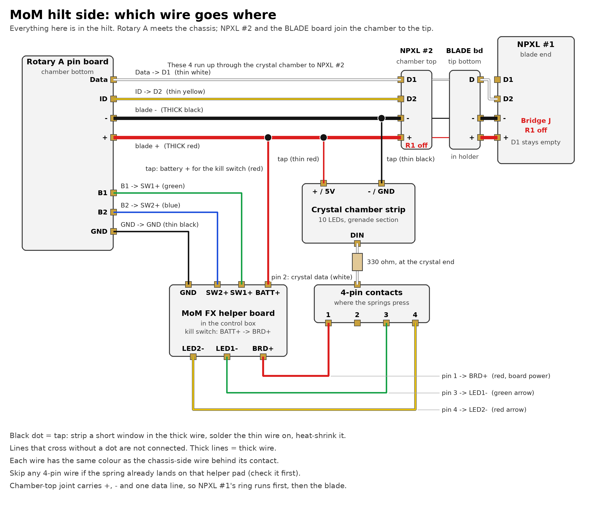
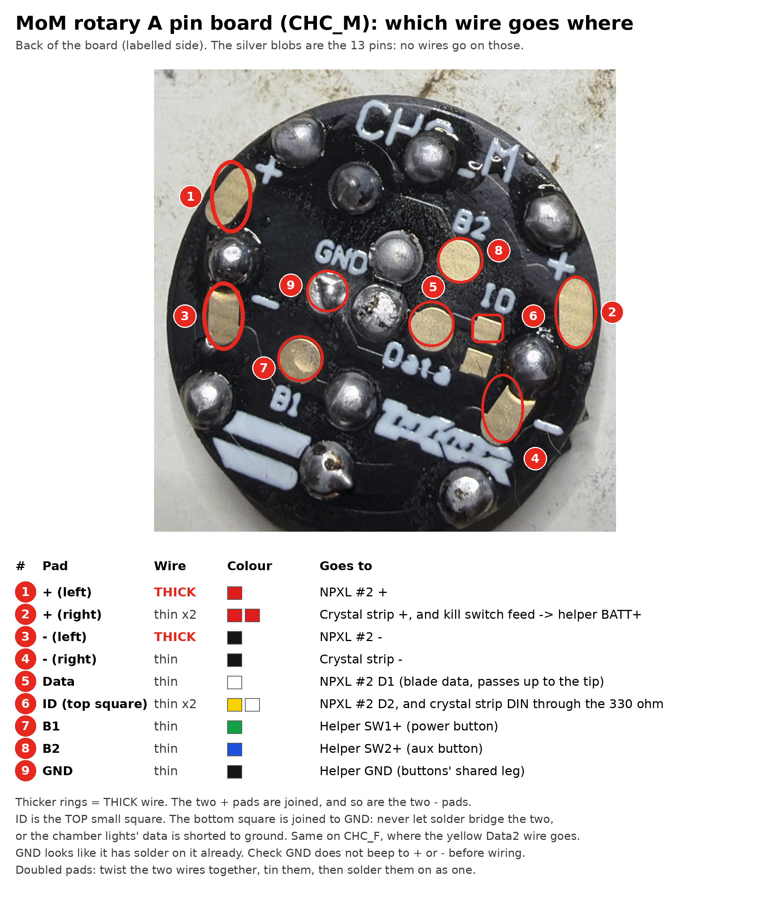

# MoM saber wiring (Proffieboard V3.9)

The diagram below comes from [Fredrik Hubbe's Proffieboard V3 configurator](https://fredrik.hubbe.net/lightsaber/v6/configurator.html). That page builds its diagram in JavaScript after you choose options, so `generate.js` loads it in headless Chromium, sets the form from `variants.json`, and saves what it draws. The pad tables are read from the configurator's own routing data, so they match the picture.

The configurator doesn't know about the Shtok rotary connector or the MoM helper board, so those sections come from Shtok's manuals, linked below.

## Parts for the MoM saber

| Part | What it does in this build |
| --- | --- |
| MoM hilt | The hilt |
| BRrogers crystal chamber | Lit by the 10-LED WS2812 mini strip |
| MoM FX helper board (Veracity calls it v4.1) | Sits in the control box behind the green reveal board. Carries the two buttons (side-push switches pressed by the box buttons) and two plain LEDs. See "MoM FX helper board" below |
| Proffieboard V3.9 + SD card | Sound board. Yours is made by Tritium Sabers and printed "PB V3.9"; Hubbe's [V3 page](https://fredrik.hubbe.net/lightsaber/v6/) lists Tritium as a V3.9 maker. The diagram photo is a V3.7, and the configurator covers the whole V3 family (`proffieboard_v3_config.h`) |
| FSC-BT909 Bluetooth module (KR Sabers carrier board) | Bluetooth: 4 thin wires to SDVDD, GND, TX and RX. See "Bluetooth board" below |
| 28 mm 4 Ω 3 W bass speaker | SPKR+ / SPKR− |
| 18650 3120 mAh protected cell (1 of the 2) | Battery. Protected cells are a few mm longer than unprotected ones, so check it fits between the spring contacts |
| Spring battery contacts | Hold the battery; it comes out to charge |
| 2 A charger | External, shared with the Obi-Wan. There's no charge port in this build |
| Shtok Rotary NeoPixel & 2 Button PCB connector set (1 set) | Joins the removable chassis to the bottom of the crystal chamber. Carries power, blade data, connector-LED data and both buttons |
| Shtok NPXL V4 hilt-side connectors (2) + 1" holder | **#1**, in the 1" holder at the blade end, is where the blade plugs in. **#2** sits at the top of the crystal chamber, pins up. Each has 16 LEDs of its own |
| Round **BLADE** board (Shtok blade-side NPXL board, 5 LEDs) + the designer's copper and black pixel holder | Sits at the bottom of the tip section, flat contacts down onto NPXL #2's pins. Joins the crystal chamber to the tip: +, − and one data line |
| 330 Ω 0603 resistor (surface-mount chip marked "331", on a paper strip; 0603 is 1.6 × 0.8 mm) | In series on the **crystal strip's** data wire, close to its DIN. Tin both ends, solder the tap from the yellow Data2 wire to one end and the strip's DIN to the other, then cover it with heat shrink |
| WS2812 mini strip, 10 LEDs | Crystal chamber light. Use all 10, or cut it to fit and set the count in the config |
| 4-pin SMT spring-loaded connector | In the chassis end, beside the rotary ring board. The designer's spec: SMT, 2.5 × 10–11 mm, uncompressed pins no taller than 4 mm. Carries the kill-switch return and the two control-box lights (see "MoM FX helper board") |
| Saberbay 1" thin-walled 36" neopixel blade | Main blade, 130 LEDs (Saberbay's formula: 36 ÷ 40 × 144 ≈ 130) |
| 1" aluminum hero NeoPixel blade plug + 4× 2 mm magnets | Goes in the blade holder when the blade is out. Saberbay's NeoPixel plugs come with their own blade-side LED board; that's the ring of gold contacts on top of yours. Lit by that board and the NPXL's 16 LEDs |
| Still needed | M3 × 8 mm countersunk screw, PTFE wire (stranded; see "Wiring the Proffieboard"), and the printed chassis (LEDO 6060 resin, from Jawa's Depot) |

## Order split: MoM vs Obi-Wan (Roman Elite Inception)

The Saber Armory order covers both sabers.

| Ordered | MoM | Obi-Wan | Shared or spare |
| --- | --- | --- | --- |
| Proffieboard v3.9 ×2 | 1 | 1 | |
| FSC-BT909 Bluetooth PCB Unit ×2 | 1 | 1 | |
| 28 mm 4 Ω 3 W speaker ×2 | 1 | 1 | |
| Rotary NeoPixel & 2 Button connector set ×2 | 1: chassis to crystal chamber | | 1 spare |
| Keeppower 18650 3120 mAh dual pack | 1 cell | | 1 spare cell |
| Keeppower 21700 5000 mAh | | 1 | |
| Spring Battery Contacts Set | ✓ | | |
| Battery Contacts Set (Keystone) | | ✓ | |
| NPXL V4 hilt side, short pins, assembled ×3 (17.5 mm) | 2: blade end and top of crystal chamber | 1 | |
| NPXL V3/V4 hilt-side holder 1" | ✓ | Not needed: its emitter takes the NPXL directly | |
| NPXL blade-side LED board (the round "BLADE" board with 5 LEDs) | ✓ chamber-to-tip joint | | Only if the Obi-Wan's blade has its own contact board; check its end |
| 330 Ω 0603 SMD resistor ×2 | 1 | 1 | |
| WS2812 2020 mini strip, 10 LEDs | ✓ | | |
| KR 128x32 OLED, white | | ✓ | |
| High Amp Kill Switch (silver C&K slide switch, marked 3A 120VAC) | See "Still to confirm" | ✓ | |
| Battery and Speaker PCB Connector Set (20.00 mm per the listing) | | ✓ | |
| Low Profile Red Tactile Switch ×2 | | ✓ | |
| Replacement Pogo Pins, short ×4 (the 4 loose pins) | | | Shared spares. They fit the rotary, battery/speaker and short-pin NPXL boards |
| 2 A charger | | | Shared |

The battery and speaker set you ordered is the one The Saber Armory lists at **20.00 mm** for both boards. The 17.5 mm version is a separately named listing, and **20.5 mm** is the rotary set's size. Measure it to be sure.

Not from this order:
- **MoM:** hilt, crystal chamber, helper board, reveal board, Saberbay blade, hero plug and magnets, 4-pin pogo connector.
- **Obi-Wan:** the Roman Elite Inception hilt (static and vented pommels, blade plug) and its Saberbay blade.
- **Not on either list:** the mini black 3-pin slide switch. It's low-current only and must never go in a blade's power line.

## Install guides for this hilt

- [Jawa's Depot: MoM + Crystal Chamber chassis](https://www.youtube.com/watch?v=wYZYZO8c3IY): the chassis designer's own video. The [product page](https://jawasdepot.com/products/mom-chassis-with-crystal-chamber) has build photos and the parts list.
- [Smugglers Outpost: 7Chambers MoM of All Heroes, Proffie Pixel Install](https://www.youtube.com/watch?v=TDhTdW2LZpU)
- [Ronin Sabers: 7even Chambers MoM Gen 2 Neopixel Install](https://www.youtube.com/watch?v=9AR8ZAMefGs)
- [BRrogers: FX reveal board assembly](https://www.therpf.com/forums/threads/fx-reveal-board-assembly-for-fx-mom-cave-hero.339167) (helper board and reveal board, RPF)

Layout, from the designer's photos, starting at the pommel: pommel → body with the control box (the removable core with board, battery and speaker goes in here) → crystal chamber → black grip → copper section → emitter with the NPXL connector. The crystal chamber is in the grenade section. The blade goes in past the thin neck to a brass cup about 1" across. The Shtok 1" holder is the same size and replaces that cup; it holds the NPXL, pins up, where the blade's end lands. (On its own, the 17.5 mm NPXL rattles around in the brass cup.) The blade wires (+, −, Data1, Data2) run up from the rotary connector past the crystal chamber to the NPXL. The NPXL's 16 LEDs light the blade plug at that end. The crystal is lit by the mini strip.

The chassis comes all the way out, so every wire from the Proffieboard ends at the chassis end: on the rotary ring board, the 4-pin connector, the battery contacts, the speaker or the Bluetooth board. The rotary connector is the pass-through that carries the blade's wires on into the hilt.

## Configurator settings

| Configurator field | Setting |
| --- | --- |
| Blade 1 | **Illuminated PCB**, 130 LEDs, RGBW off, ZigZag off, Blade Detect **off** |
| Button 1 / Button 2 / Button 3 | Momentary / Momentary / None |
| Display | None |
| Charge Port | **off** |
| Blade 2 | None |
| Bluetooth | FSC-BT909 |
| Kill switch | off |
| Blade 3 | Neopixel crystal chamber, 10 LEDs |
| IR receiver, Reverse orientation | off |

"Illuminated PCB" is the configurator's option for a lit pogo connector like the NPXL V4. The board it draws has the same + / − / D1 / D2 / BD pads.

## Wiring diagram


## Wiring the Proffieboard: thick or thin


Use **thick** wire only where the blade's current flows: the battery in and out, and the blade's + and −. Everything else gets **thin** wire. Hubbe's [V3 page](https://fredrik.hubbe.net/lightsaber/v6/) says most pads carry almost no current and can use 30 AWG, but the battery wires carry the combined current of every LED. Shtok's NPXL manual asks for 20–22 AWG on the blade's + and −.

| Proffieboard pad | Wire | Runs to | Notes |
| --- | --- | --- | --- |
| **BATT+** | **Thick** (thin would also do) | Kill-switch return: 4-pin connector **pins 1 and 2** → helper **BRD+** | Only the board's own current flows here (about 1 A at most, at full volume), because the blade takes its + straight from the battery. At the pogo end, lay the wire alongside the pin's leg and solder it there, then heat-shrink it |
| **BATT−** | **Thick** | Battery − | Every LED's current comes back through here |
| **LED2 + LED3** | **Thick** | Blade −: rotary **−** → NPXL **−** | The two pads are next to each other. Strip enough wire to lay across both and solder them together |
| **GND** | Thin | Shared leg of both buttons: rotary **GND** → helper **GND** | GND and BATT− are joined on the board, so any GND or BATT− pad works |
| **GND** | Thin | BT909 **GND** | |
| **Data1** | Thin | Rotary **Data** → NPXL **D1** (blade) | Data1 has a 470 Ω resistor built in, so no extra resistor |
| **Data2** | Thin | Rotary **ID** → NPXL **D2** (connector's 16 LEDs) | The NPXL has its own 330 Ω (R2) on D2 |
| **Data3** | None | Spare, not used | If you already soldered a wire here, tape its end. The crystal strip takes its data from Data2 in the crystal chamber |
| **LED1** | None | Spare, not used | If you already soldered a wire here, tape its end and tuck it away. The crystal's − now comes from the blade − line in the hilt |
| **BT1** | Thin | Rotary **B1** → helper **SW1+** (power) | |
| **BT2** | Thin | Rotary **B2** → helper **SW2+** (aux) | |
| **RX** | Thin | BT909 **TX** | TX and RX cross over |
| **TX** | Thin | BT909 **RX** | |
| **SDVDD** | Thin | BT909 **+ / VCC** | Switched 3.3 V |
| **SPKR+ / SPKR−** | Thin | Speaker | Under 1 A even at full volume (3 W into 4 Ω) |
| **LED5 / LED6** | Thin | 4-pin connector **pin 3 / pin 4** → helper **LED1− / LED2−** | The control box's two arrow lights. The designer's pinout calls them LEDx and LEDy |

One + wire doesn't go on the Proffieboard at all: **blade +** (thick) is soldered at the **battery's + contact** and runs to rotary **+** → NPXL **+**. Shtok's rotary diagram feeds the blade + straight from the battery the same way.

In the hilt, two things tap that blade + wire: the kill switch's battery feed (helper **BATT+**) and the crystal's **+**. The crystal's **−** taps the blade − wire the same way. See [Hilt side: step by step](#hilt-side-step-by-step).

Keep blade + on the battery side, before the kill switch. Small slide switches like the ones in this order are rated around 3 A or less, and the blade can draw more than that. Wired this way, the switch only carries the board's own current. The blade still goes dark when the switch is off: blade − runs through the board's LED2/LED3 switches, and Hubbe's V3 page notes those have pull-down resistors that turn them off when the board has no power.

**Use stranded wire for the final install, not solid core.** Solid wire is stiff. It pries at the pads, and wires that bend repeatedly (removable chassis, battery swaps, clashes) tend to crack next to the solder joint. Silicone or PTFE stranded wire is the usual choice; Shtok pre-wires its NPXL connectors with PTFE, 22 AWG for + and −. The 22 AWG solid-core box is fine for a bench test. For the four thick wires in the saber, get about 1 m (3 ft) each of red and black 22 AWG stranded.

Colour plan for black, red, white, green, yellow and blue. Each group of wires that ends at the same part has no repeated colour, except the thick and thin black at the rotary connector, which you can tell apart by size. Flag each wire's far end with masking tape anyway.

| Ends at | Wires (Proffieboard pad → colour) |
| --- | --- |
| Rotary connector (chassis side) | blade + **red thick** (from the battery + contact), LED2+LED3 **black thick**, GND (pad 5) black thin, Data1 white, Data2 yellow, BT1 green, BT2 blue |
| 4-pin connector (chassis end) | BATT+ red thick (pins 1 and 2), LED5 green (pin 3), LED6 yellow (pin 4) |
| Battery contacts | + : blade + **red thick**. − : BATT− **black thick** |
| Bluetooth board | SDVDD red, GND black, TX yellow, RX blue |
| Speaker | SPKR+ and SPKR− both green. Polarity doesn't matter with one speaker |

Tips for long wires you'll trim later:

- **Length:** the chassis-side wires only need to reach the end of the chassis, where the rotary ring board (CHC_F) and the 4-pin pogo sit, not the emitter. The hilt side gets its own wires from the pin board (CHC_M) and the 4-pin's contacts. Cut each wire to reach the far end of the chassis plus about 5 cm (2"). If you can't measure yet, 20 cm (8") each is plenty.
- **Bench test first:** with the wires long, you can hook up the battery, speaker, buttons and blade connector on the bench, flash the config and test everything before trimming anything.
- Use red and black for the thick + and − wires.
- Give each thin wire a different colour and write down which colour is on which pad. Once the wires are trimmed and bundled, that list is the only way to tell them apart.
- Tin the pads and the wire ends before you join them.

On the crystal strip, use the end whose arrows point away from the wire (DIN), and connect the strip's 5V/+, DIN and GND/− pads.

## Bluetooth board (KR Sabers BT909 module PCB)

The BT909 is mounted on a KR Sabers carrier board, sold by The Saber Armory as the [FSC-BT909 Bluetooth PCB Unit](https://thesaberarmory.com/products/shtokcustomworx-fsc-bt909-bluetooth-pcb-unit). The pads are labeled on the back. The listing's [wiring image](https://cdn.shopify.com/s/files/1/0262/5368/8868/products/SCW-BT909-3.jpg) marks RX "to TX" and TX "to RX", so the data wires cross over, the same as the configurator draws.

| BT909 board pad | Proffieboard pad | Wire |
| --- | --- | --- |
| **+3.3V** | SDVDD | Thin |
| **GND** (the one next to +3.3V) | GND | Thin |
| **RX** | **TX** | Thin |
| **TX** | **RX** | Thin |
| Second **GND**, **LED 1**, **LED 2** | Leave empty | Only for optional external status LEDs. The board already has its own two |

SDVDD is a 3.3 V supply the Proffieboard can switch off in low-power mode, which is why the configurator uses it for Bluetooth.

## Shtok NPXL V4 hilt-side connector

From Shtok's [NPXL V4 manual](https://drive.google.com/file/d/1S0gRH6mnw8OvC6XNEBnWZGeY1ES1nhG6/view), the hilt-side board has these pads:

Where each pad is on the back (the side printed **HILT**), from the manual's page 6 diagram:

| NPXL pad | Where it is | Wire to |
| --- | --- | --- |
| **D1** | The big round pad dead centre, with "D1" printed below it | Data1 (blade): white |
| **D2** | The small round pad on the left edge, printed "D2", between R2 above and R1 below | Data2 (the 16 on-board LEDs): yellow |
| **−** | The gold pads around the centre, with "−" printed either side of "HILT" | LED2 + LED3: thick black |
| **+** | The outer pads: the big square ones at top and bottom and the round outer ones printed "+" | Battery +: thick red |
| **BD** | The inner pad at lower right, printed "BD" | Not used. Blade detect is off (see below). Keep solder from bridging it to the − pads |
| **J** | Small jumper pads near the bottom | Leave open. It's only bridged for the manual's Option 3 |

The manual's wire sizes for + and −: one 22 AWG, two 24 AWG or three 26 AWG wires each, soldered to any of that polarity's pads. Data wires can be 28–30 AWG.

The MoM has two of these. **NPXL #2**, at the top of the crystal chamber, is wired as below (Option 4). **NPXL #1**, at the blade end, gets only one data line through the chamber-top joint, so it uses the manual's **Option 3**: data into **D2**, R1 removed, jumper **J** bridged, D1 left empty. Its 16 LEDs then come first in the chain and the blade follows.

This is the manual's **Option 4**: blade and connector LEDs on separate data wires, which is also what the configurator draws. **Option 4 needs resistor R1 removed.** R1 is the tiny resistor next to D2, labeled R1 in the diagram. If R1 is still fitted, D1 and D2 are tied together through it, and two data outputs end up fighting each other. Leave R2 in place.

The manual's own Proffieboard example for Option 4 matches this config: blade on Data1 and the connector's 16 LEDs on Data2, both on `PowerPINS<bladePowerPin2, bladePowerPin3>`, with `SHARED_POWER_PINS`. The only difference is that this config splits the 16 LEDs into two interleaved halves, as the configurator does. Both work.

## Shtok rotary connector (Rotary NeoPixel & 2 Button set)

This is a pass-through. Every ring on the female board (CHC_F) touches the same-named pins on the male board (CHC_M), in any rotation. Shtok's [Proffieboard diagram](https://cdn.shopify.com/s/files/1/0262/5368/8868/products/image_90123a68-bfdd-4d91-a77c-03377dd314f2.png) puts the pin board (CHC_M) on the Proffieboard side. The Jawa's Depot MoM build video has it the other way round: the **ring board (CHC_F)** on the end of the chassis, next to the 4-pin pogo, and the **pin board (CHC_M)** in the hilt. Electrically it's the same either way, so follow the chassis. A frame from the same video shows the ring board on the chassis tip, with the 4-pin connector's four contacts just above it. The pin board sits in the crystal chamber, and its spring pins press on the ring board when the chassis is in.

| Pad (same on both boards) | Chassis side: from the Proffieboard | Hilt side: to |
| --- | --- | --- |
| **+** | Battery + contact (thick) | NPXL + |
| **−** | LED2 + LED3 | NPXL − |
| **Data** | Data1 | NPXL D1 |
| **ID** | Data2 | NPXL D2 (repurposed; see below) |
| **B1** | BT1 | Helper **SW1+** (power button) |
| **B2** | BT2 | Helper **SW2+** (aux button) |
| **GND** | GND (pad 5) | Helper **GND** (shared leg of both buttons) |

On both boards, **ID** is the upper of the two small square pads next to the "ID" label. The lower square is joined to GND (it's for an optional ID resistor), so never let solder bridge the two: that would short Data2 to ground.

This set has one data contact plus an **ID** contact. The blade and the connector LEDs need two data wires, so this wiring carries the connector-LED data (D2) on ID. That leaves no contact for the NPXL's blade-detect (BD) pin, which is why Blade Detect is off.

In the MoM the buttons do use B1, B2 and GND, because the 4-pin pogo is taken up by the kill switch and the control-box lights. On the hilt side, three short wires run from the pin board (CHC_M) to the helper board.

The joint between the crystal chamber and the tip section uses NPXL #2 and the BLADE board instead (see [Hilt side](#hilt-side-step-by-step)). No CHC part fits at the top of the chamber.

## MoM FX helper board

Veracity calls this board **v4.1**. The "V1" and "V2" on the chassis page are the chassis designer's labels, and I found nothing that connects them to Veracity's version numbers. The designer describes V2 as having plain LEDs, which matches this board, but that doesn't confirm v4.1 is V2.

The board sits in the control box behind the green reveal board, in a brass housing that screws together with the crystal chamber. It carries the kill switch (a slide switch), F1, the two plain LEDs with R1 and R2, and the two side-push switches. Its wire pads are plated through-holes: LED1− and LED2− and SW1+ on one row, and BATT+, SW2+, BRD+, DATA1, DATA2 and GND on the other. Nothing touches it directly. All its wires come in through a gap from CHC_M and the 4-pin. The control-box buttons press its two side-mounted switches, per BRrogers's [assembly thread](https://www.therpf.com/forums/threads/fx-reveal-board-assembly-for-fx-mom-cave-hero.339167). I couldn't find a wiring guide for it, so this mapping comes from its printed labels. Run the checks below before soldering.

| Helper board pad | Proffieboard pad | How sure |
| --- | --- | --- |
| **SW1+** | BT1, through rotary B1 | Likely. Signal side of switch SW1 |
| **SW2+** | BT2, through rotary B2 | Likely |
| **GND** | GND (pad 5), through rotary GND | Likely. Common for both switches |
| **BATT+** | Battery +: thin red from CHC_M's second + pad | The kill switch's input. It's not on the designer's 4-pin pinout, so it comes from the hilt side |
| **BRD+** | BATT+ pad, through 4-pin **pin 1** | Designer: "Pin1 = Kill Switch-to-Board Batt+". Run check 2 |
| **LED1−** | LED5, through 4-pin **pin 3** | Designer: "Pin3 = LEDx arrow neg-". Run check 3 |
| **LED2−** | LED6, through 4-pin **pin 4** | Designer: "Pin4 = LEDy arrow neg-" |
| **DATA1 / DATA2** | Leave unconnected | Run check 4. Plain LEDs don't take data. Nothing in this build needs them |

For the MoM, the chassis designer's notes give the 4-pin connector's pinout (for the plain-LED helper board):

| Pin | Designer's label | Proffieboard wire |
| --- | --- | --- |
| 1 | Kill Switch-to-Board Batt+ | BATT+ (pad 4), red thick |
| 2 | Extra: a second Batt+, or an extra data line | BATT+ too, with pin 1. Two pins share the board's current, as the designer recommends, so no single-pin load test is needed |
| 3 | LEDx arrow neg- | LED5 (pad 10), green |
| 4 | LEDy arrow neg- | LED6 (pad 11), yellow |

- **4-pin connector:** a single spring-loaded SMT strip in the chassis end. Its pins press on contacts in the hilt, so there's no second half to make. The designer says that if your pins are shorter than the chassis expects, a dab of hot glue or tape inside the pommel cap corner keeps them in contact. Check in the designer's video or photos which end is pin 1 before soldering.
- **Rotary connector:** blade +, blade −, Data1, Data2 (on ID), and the buttons on B1, B2 and GND.

If the green and red arrow lights come out swapped, swap `bladePowerPin5` and `bladePowerPin6` in the config.

Checks, using a multimeter in continuity (beep) mode with nothing connected:

1. **Buttons:** hold the top switch. **SW1+ ↔ GND** should beep only while it's pressed. Do the same with the second switch and **SW2+**.
2. **Power:** test **BATT+ ↔ BRD+**.
   - If it beeps, they're joined, probably through F1 as a fuse, and the kill switch is somewhere else in the hilt.
   - If it doesn't beep, see whether BATT+ and BRD+ each beep to one of the three big **U$2** pads. If they do, U$2 is probably where the 3-pin slide switch (kill switch) goes.
3. **LEDs:** **LED1−** should beep to a pad of the white part marked LED1. **LED2−** should do the same with LED2.
4. **Data:** find out where **DATA1** and **DATA2** go. Test each one against the three **U$2** pads and the other parts on the board. Nothing in this build needs them, so leave both empty.

The config already drives LED1 and LED2 as two plain LEDs on LED5 and LED6 (blades 4 and 5).

## Hilt side: step by step

None of the install videos show this wiring, so it's worked out from the parts' pinouts and the chassis designer's notes. The hilt side has three groups of wires:

- **Up through the crystal chamber: 4 wires.** Blade + and − (thick), Data and ID (thin), from rotary **A**'s pin board at the bottom of the chamber to **NPXL #2** at its top, pins up. Its own 16 LEDs take ID (Data2).
- **The chamber-to-tip joint:** NPXL #2's pins press on the **BLADE** board, held in the designer's copper and black pixel holder at the bottom of the tip section. Only +, − and one data line (the centre pin) cross it.
- **Tip section: 3 wires.** From the BLADE board up to **NPXL #1** at the blade end. NPXL #1 is chained (Option 3): data into D2, J bridged, so its 16 LEDs come first and the blade follows.
- **At the crystal chamber: 3 wires to the strip.** + and − tapped off the blade + and − wires as they pass, and data tapped off the yellow Data2 wire through the 330 Ω. The strip shows the same pattern as NPXL #2's ring. No wire crosses from the chassis.
- **At the helper board in the control box:** the buttons (B1, B2 and GND from the rotary pin board), battery + for the kill switch (a tap off blade +) and the 4-pin contacts.



Rotary A's pin board (CHC_M), pad by pad, on the photo of the real board:



| From | To | Wire | Colour |
| --- | --- | --- | --- |
| Rotary A pin board **+** | NPXL #2 **+** | Thick | Red |
| Rotary A pin board **−** | NPXL #2 **−** | Thick | Black |
| Rotary A pin board **Data** | NPXL #2 **D1** | Thin | White |
| Rotary A pin board **ID** | NPXL #2 **D2** | Thin | Yellow |
| BLADE board **+** (the four outer pads marked +) | NPXL #1 **+** | Thick | Red |
| BLADE board **−** (the pads marked −) | NPXL #1 **−** | Thick | Black |
| BLADE board **D** (top centre, above its resistor) | NPXL #1 **D2** | Thin | White (it carries Data1, the blade's data) |
| Rotary A pin board **B1** | Helper **SW1+** | Thin | Green |
| Rotary A pin board **B2** | Helper **SW2+** | Thin | Blue |
| Rotary A pin board **GND** | Helper **GND** | Thin | Black |
| Tap on blade + | Helper **BATT+** (kill switch in) | Thin will do; thick if it fits | Red |
| Tap on blade + | Crystal **+ / 5V** | Thin | Red |
| Tap on blade − | Crystal **− / GND** | Thin | Black |
| Tap on the yellow Data2 wire | **330 Ω** → crystal **DIN** | Thin | Yellow |
| 4-pin **pin 1** and **pin 2** contacts | Helper **BRD+** (kill switch out) | Thin will do; thick if it fits | Red |
| 4-pin **pin 3** contact | Helper **LED1−** | Thin | Green |
| 4-pin **pin 4** contact | Helper **LED2−** | Thin | Yellow |

Each wire has the same colour as the chassis-side wire behind its contact, so a colour means the same thing end to end.

1. **Find where the 4-pin springs land.** Fit the chassis and see what the four springs press on in the hilt. If they land on helper board pads, those pads set the pin order: the spring on **BRD+** is pin 1 and gets the red BATT+ wire on the chassis side, and so on. If they land on blank contacts, you pick the order; keep the colours as in the tables. With the multimeter on beep, also test each landing spot against the helper's pads. Any that's already joined to its pad (pin 1 → BRD+, pin 3 → LED1−, pin 4 → LED2−) needs no wire in step 7.
2. **NPXLs:** remove **R1** on both and leave R2. On **NPXL #1** also bridge **J** and leave **D1** empty.
3. **Blade wires, in two runs.**
   - **Chamber-to-tip joint:** press the BLADE board into the pixel holder, flat contact face down (toward the chamber), the side printed "BLADE" up. Fit the holder at the bottom of the tip section. Dry-fit the tip onto the chamber with NPXL #2 in place: its pins should compress partway and the centre pin should land on the BLADE board's centre pad.
   - **Tip section:** BLADE board → NPXL #1. + → +, − → −, D → D2. Work out of the tip section's open bottom with it unscrewed, and leave only a couple of cm of slack.
   - **Crystal chamber:** rotary A's pin board → NPXL #2. + → +, − → −, Data → D1, ID → D2. Before soldering the thick ones, slide on heat shrink for the taps: two pieces on the red (crystal + and kill switch), one on the black (crystal −).
4. **Buttons.** Rotary A pin board B1 → SW1+, B2 → SW2+, GND → GND. Short thin wires.
5. **Taps.** Where a tap goes, score round the thick wire's insulation twice about 5 mm apart, slit between the cuts and peel that piece off. Wrap the thin wire's tinned end once round the bare strands, solder, then slide the heat shrink over and shrink it.
   - Blade + → crystal + (thin red) and blade − → crystal − (thin black), where the wires pass the crystal chamber.
   - Blade + → helper BATT+ (red), near the control box. If rotary A's + pad has room, you can instead lay this wire alongside the thick one on that pad.
   - The crystal's − goes on the blade − wire, not the helper's GND. The board switches blade − off with the blade, so the crystal goes fully dark. On GND, its LEDs would draw a few mA all the time, even with the kill switch off.
6. **Crystal data.** Tap the yellow Data2 wire (rotary A's ID → NPXL #2's D2) inside the chamber, the same way as the + and − taps. Run that tap to the strip, stop about 1 cm short of DIN, solder the 330 Ω in line there, add a short stub to DIN and heat-shrink over the resistor. Use the strip's DIN end, where the arrows point away from the wire.
7. **4-pin contacts to the helper**, unless step 1 showed they're already joined: pins 1 and 2 → BRD+, pin 3 → LED1−, pin 4 → LED2−.
8. **Multimeter checks, battery out.**
   - Should beep, with the chamber and tip screwed together: rotary A pin board + ↔ NPXL #1 +, − ↔ NPXL #1 −. Rotary A Data ↔ NPXL #2 D1. Crystal + ↔ blade +, crystal − ↔ blade −.
   - Must not beep: NPXL #1 D1 to anything (it stays empty), and rotary A Data ↔ rotary A ID.
   - Must not beep: blade + ↔ blade −, and helper BATT+ ↔ helper GND.
   - Kill switch off: helper BATT+ ↔ BRD+ silent. On: it beeps.
9. **First power-up.** Kill switch off, battery in, chassis in, then switch on: you should hear the boot sound. Ignite. The blade, both NPXLs' LEDs, the crystal and both arrow lights should come on.
   - Crystal dark: check it's wired at the DIN end, check the 330 Ω joints, and check the LED count in the config.
   - Arrow colours swapped: swap `bladePowerPin5` and `bladePowerPin6` in the config.
   - **4-pin check:** run it for a few minutes at full volume with some swings and clashes. The 4-pin should be no more than slightly warm, and the board shouldn't restart on loud clashes. If it does either, lower `VOLUME`.

## Still to confirm

- **`RING_LEDS`:** 16 or 21, from the dark-LED count at the blade tip (see the config section).
- **Brass-cup part:** confirm it faces up toward the blade, so NPXL #1 and the 1" holder go there.
- **BLADE board:** confirm the Obi-Wan's blade has its own contact board, so this one is free for the MoM.
- **Helper board:** the four checks above, and whether Veracity's v4.1 is the chassis designer's V2.
- **Kill switch for the MoM:** already on the helper board: the 3-leg slide switch at its left end, between BATT+ and BRD+. Because blade + comes straight from the battery, it only carries the board's own current, about 1 A at most. Check: switch on, BATT+ ↔ BRD+ beeps; switch off, silent.
- **4-pin connector part:** the designer's spec is a 4-pin **SMT** spring-loaded connector, 2.5 × 10–11 mm, with uncompressed pins no taller than 4 mm (the chassis takes 3 or 4 mm). The Treedix strip doesn't fit that: it's through-hole, and its 7.5 mm pins are nearly twice the maximum. Measure the 4-pin SMT connector you already had. If it's about 2.5 × 10–11 mm with pins no taller than 4 mm, it's the right part after all, used springs-out with no flipped strip or target. If not, look for one to that spec, for example on Mouser as the designer suggests.

## ProffieOS config to flash: `proffieos/mom_config.h`

[`proffieos/mom_config.h`](proffieos/mom_config.h) is the config to flash. It starts from the configurator's output (`out/mom/config.h`) and adds the control box's two lights, Bluetooth and save-state. It compiles cleanly against **ProffieOS 8.10** for Proffieboard V3: the firmware uses about 190 KB of 512 KB of flash and about 31 KB of RAM.

| Blade (in preset order) | Hardware | Pins |
| --- | --- | --- |
| 1 | Main blade, 130 pixels, after the ring on the same strip | Data1, LED2 + LED3 |
| 2 | NPXL #1's ring at the blade end: the first `RING_LEDS` pixels on Data1 (16, or 21 if the BLADE board's 5 LEDs are in the chain) | Data1, LED2 + LED3 |
| 3 | Crystal chamber lights: NPXL #2's 16-pixel ring at the top of the chamber, and the 10-pixel crystal strip tapped onto the same data wire (it copies the ring's first 10) | Data2, LED2 + LED3 |
| 4 | Control box green light | LED5 |
| 5 | Control box red light | LED6 |

**`RING_LEDS`** is 16: the BLADE board's 5 LEDs most likely tap its data line in parallel, so they don't take places in the chain. If the top 5 blade LEDs stay dark after flashing, set it to 21 and reflash.

| Preset | Font folder | Look |
| --- | --- | --- |
| luke rotj | `LukeROTJ` (your Luke font) | Green with audio flicker, crystal pulsing green |
| jedi green | `SmthJedi` (free) | Same, with Hubbe's free Smooth Jedi font |
| jedi blue | `SmthGrey` (free) | Blue |
| battery level | `TeensySF` (free) | Blade shows the battery charge |

Before flashing:
- If you cut the crystal strip, change the `10` in the crystal line (`WS281XBladePtr<10, blade3Pin, ...>`) to the number of LEDs you kept.
- `VOLUME 1000` is moderate. Hubbe's default V3 config uses 2200, so raise it if the speaker is too quiet.
- `CLASH_THRESHOLD_G 1.0` is the configurator's default. If swings set off clashes, raise it to 2–3.

### After soldering the Proffieboard

1. **Short check, before any power.** Look for solder bridging two pads; pad 9 (LED2 + LED3) is the only pair that should be joined. With a multimeter on beep, BATT+ (pad 4) to BATT− (pad 6) must not beep, and nor must BATT+ to GND.
2. **Flash over USB** (steps below). USB powers the board, so no battery is needed. Open the Serial Monitor and type `help` to check it's alive.
3. **Prepare the SD card** (below) and insert it.
4. **Bench test on USB:**
   - Connect the speaker: you should hear the boot sound.
   - Briefly touch the BT1 (green) wire to a GND (black) wire. That's a power-button press, so you should hear ignition.
   - Connect the Bluetooth board and look for it on your phone.
5. **Bench test on the battery:**
   - Board power comes back through the kill switch in the hilt, so until the hilt is wired, temporarily connect the red BATT+ wire (pad 4) to the battery's + contact. That stands in for the switch.
   - Test the real NPXL and blade. Remove R1 from the NPXL first. Then clip or tack the NPXL's **+** to the battery's +, **−** to pad 9's thick black wire, **D1** to Data1 (white) and **D2** to Data2 (yellow), and plug the blade in.
   - No NPXL handy? Use 6–8 leftover mini-strip LEDs as a test blade: + to battery +, − to pad 9's thick wire, DIN to Data1.
   - Always connect the battery the right way round. Neopixels can fry if it's reversed.
6. **Then the connectors and far ends:**
   - Chassis side: the rotary ring board, the 4-pin connector, the battery contacts, the speaker and the Bluetooth board.
   - Hilt side: follow [Hilt side: step by step](#hilt-side-step-by-step). It covers R1, the helper board, the crystal and the kill switch.

### Flashing

1. Install the [Arduino IDE](https://www.arduino.cc/en/software). In **File → Preferences → Additional boards manager URLs**, add `https://profezzorn.github.io/arduino-proffieboard/package_proffieboard_index.json`, then install **Proffieboard** from the Boards Manager.
2. Download [ProffieOS 8.10](https://fredrik.hubbe.net/lightsaber/ProffieOS-v8.10.zip) from Hubbe's site and unzip it. The folder must stay named `ProffieOS`.
3. Copy `mom_config.h` into `ProffieOS/config/`.
4. Open `ProffieOS/ProffieOS.ino`. Remove the `// ` from the `CONFIG_FILE` line and change it to `#define CONFIG_FILE "config/mom_config.h"`.
5. In **Tools**, set:
   - **Board:** Proffieboard V3
   - **USB Type:** Serial + WebUSB + Mass Storage
   - **DOSFS:** SDIO (High Speed). ProffieOS refuses to compile otherwise.
6. Tape every loose wire end and leave the battery disconnected. Then plug the board in with a data USB cable, pick its port and click **Upload**.
7. If the upload fails or no port appears, hold the board's **BOOT** button, press and release **RESET**, let go of BOOT, and click Upload again. That's from Hubbe's [V3 page](https://fredrik.hubbe.net/lightsaber/v6/).
8. Open the Serial Monitor and type `help`. A list of commands means it's running. Without the SD card it will complain about missing fonts, which is expected.

### SD card

1. Format the card as FAT32.
2. Download Hubbe's free [ProffieOS SD card zip](https://fredrik.hubbe.net/lightsaber/sound/) (about 207 MB). Copy everything *inside* its `ProffieOS_SD_Card` folder to the root of the card: `RgueCmdr`, `SmthFuzz`, `SmthGrey`, `SmthJedi`, `TeensySF`, `TthCrstl`, `tracks` and `readme.txt`.
3. Until you have a Luke font, copy `SmthJedi` and name the copy **`LukeROTJ`**, so preset 1 works straight away.
4. When the Luke font arrives, empty `LukeROTJ` and put the font's files directly in it (hum, swing and clash `.wav` files and its `.ini` files, not a nested folder). No reflash needed.
5. Font packs often include versions for several boards. Use the **Proffie** folder only; a Xenopixel or CFX folder uses that board's own file layout and won't play on a Proffieboard.

### Luke sound fonts

Most Luke fonts are paid. These are made for Proffie or are well known:

| Font | Price | Notes |
| --- | --- | --- |
| [Father and Son (Luke ROTJ) for Proffie](https://saberfont.com/Father-and-Son-for-Proffie_p_816.html), by Juansith on Saberfont.com | $12 | Proffie version. Comes in **Normal** and **Cave Scene** versions, which suits a cave-build hilt. Also has 52 clashes, a quotes pack and two tracks. Needs a Saberfont account; check it's in stock |
| [Luke EP6](https://www.bksabersounds.com/products/luke-ep6-saber-sound-font), BK Saber Sounds | $10 | "A faithful reimagination" of the ROTJ saber. Check the download includes a Proffie version |
| Kyberphonic "The Return" V1/V2 | – | A known Luke ROTJ font ([demo](https://www.youtube.com/watch?v=BhgDvPhueDc)), but Kyberphonic's website currently shows a parked page |
| Smooth Jedi (`SmthJedi`) | Free | Not Luke-specific. Included in Hubbe's SD card download, and already the config's second preset |

## Regenerating

Edit `variants.json`. The `form` keys are the configurator's form field ids. Then run:

```sh
npm i playwright && npx playwright install chromium   # once
node generate.js                                        # writes out/<variant>/
```

Each `out/<variant>/` folder contains `diagram.png`, `config.h`, `wires.md` (readable wire list) and `wires.json`.
