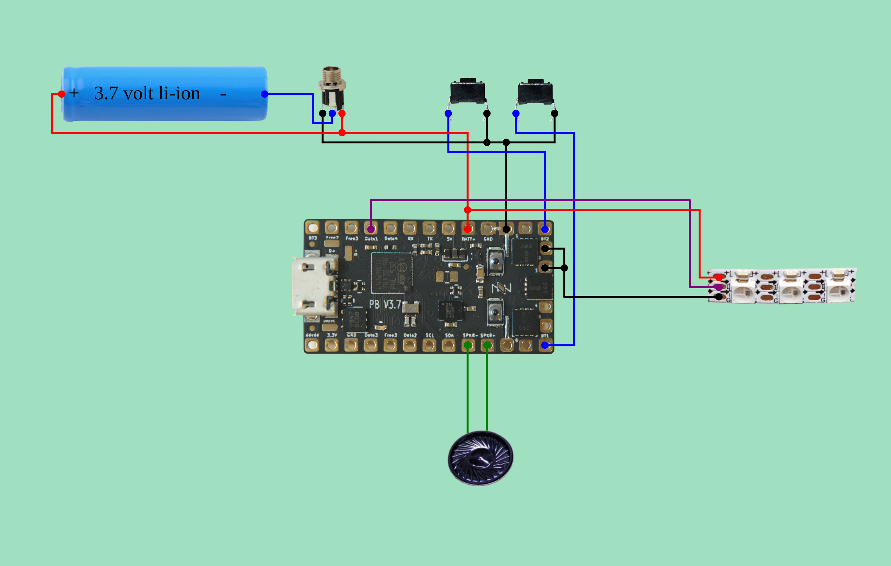
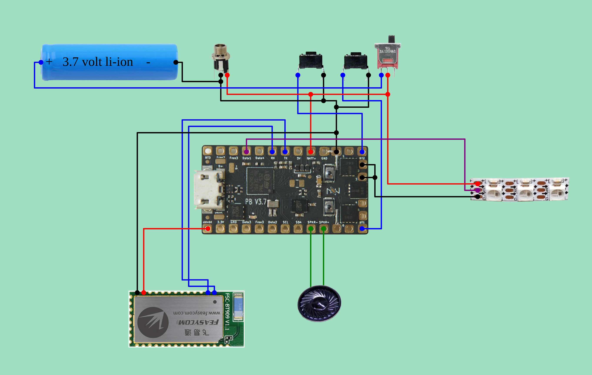

# Proffieboard V3 saber wiring

The diagrams here come from [Fredrik Hubbe's Proffieboard V3 configurator](https://fredrik.hubbe.net/lightsaber/v6/configurator.html). That page builds its diagram in JavaScript after you choose options, so `generate.js` loads it in headless Chromium, sets the form, and saves what it draws. The pad-by-pad wire lists are read from the configurator's own routing data (`grid.connections`), so they match the picture.

## Build

- Main blade: neopixel (WS2811), **130 LEDs**, plugged in through a Shtok blade connector
- **2 momentary buttons**: Power and Aux
- Charge port
- Speaker and 3.7 V li-ion battery
- Optional: kill switch and Bluetooth (FSC-BT909), shown in the second variant

## Variant 1: blade, 2 buttons, charge port



| Part / wire | Goes to on the Proffieboard | Notes |
| --- | --- | --- |
| Blade **+** (red) | **BATT+** pad | Blade power comes straight from the battery |
| Blade **data** (purple) | **Data1** pad | `bladePin` in the config |
| Blade **−** (black) | **LED2** and **LED3** pads | Bridge LED2 and LED3 together and run one wire to them. Two FETs share the blade current: `PowerPINS<bladePowerPin2, bladePowerPin3>` |
| Power button, leg 1 | **BT1** pad | `powerButtonPin` |
| Power button, leg 2 | **BATT−** pad | Buttons switch to ground |
| Aux button, leg 1 | **BT2** pad | `auxPin` |
| Aux button, leg 2 | **BATT−** pad | Shares the ground wire with the power button |
| Speaker + / − | **SPKR+** / **SPKR−** pads | |
| Battery **+** | **BATT+** pad | |
| Battery **−** | Charge port sleeve lug (the charger's −) | Battery − does **not** go straight to the board |
| Charge port switched lug | **BATT−** pad | Opens when a plug is inserted, so the board is cut off while charging |
| Charge port center pin | **BATT+** pad | |

To find the switched lug on the charge port, use a multimeter in continuity mode. The switched lug connects to the sleeve lug when no plug is inserted and disconnects when one is.

## Variant 2: plus kill switch and Bluetooth



The blade, buttons and speaker are wired the same as in variant 1. These wires change:

| Part / wire | Goes to | Notes |
| --- | --- | --- |
| Battery **+** | Kill switch, pin 1 | The switch interrupts battery + |
| Kill switch, pin 2 | **BATT+** pad | |
| Battery **−** | **BATT−** pad | Goes direct now; the charge port no longer breaks it |
| Charge port sleeve lug | **BATT−** pad | |
| Charge port center pin | **BATT+** pad | This is the board side of the kill switch, so **the switch must be on to charge** |
| BT909 GND | **BATT−** pad | |
| BT909 + | **SDVDD** pad | Switched 3.3 V |
| BT909 TX | **RX** pad | TX and RX cross over |
| BT909 RX | **TX** pad | |

The config also needs `#define ENABLE_SERIAL`, which `out/neopixel-130-2btn-killswitch-bt909/config.h` already includes.

## The Shtok connector

The configurator doesn't have a "Shtok" option. A neopixel blade connector just carries the three blade wires, so it sits between the hilt and the blade on those three lines. Wire its hilt-side pads like this:

| Connector pad | Proffieboard pad |
| --- | --- |
| **+** / positive | BATT+ |
| **Data** (D1) | Data1 |
| **−** / negative | LED2 + LED3 (bridged) |

Match these by the labels printed on your connector's PCB. I couldn't check Shtok's exact pad layout from here. If your connector has extra pads, such as a second data pad or a blade-detect pad, this config doesn't use them. Check Shtok's documentation for your connector before deciding whether a second data pad needs to be tied to Data1.

## Config checks

Both `config.h` files contain:

```cpp
#define NUM_BLADES 1
#define NUM_BUTTONS 2
...
WS281XBladePtr<130, bladePin, Color8::GRB, PowerPINS<bladePowerPin2, bladePowerPin3> >()
...
Button PowerButton(BUTTON_POWER, powerButtonPin, "pow");
Button AuxButton(BUTTON_AUX, auxPin, "aux");
```

- **130** is the LED count per data line. If your blade has two strips that both get the same data signal, use the count of one strip. If it's one strip that runs up and back down (zig-zag), set the ZigZag option in `variants.json` and regenerate.
- The presets use the configurator's example font folders (`TeensySF`, `SmthJedi`, …). Replace them with the font folders on your SD card.
- No 470 Ω resistor appears on the main blade's Data1 wire. The configurator only draws one for second-blade and crystal-chamber neopixel data lines.

## Regenerating

Edit `variants.json`. The `form` keys are the configurator's form field ids, and the select values are listed in the page source. Then run:

```sh
npm i playwright && npx playwright install chromium   # once
node generate.js                                        # writes out/<variant>/
```

Each `out/<variant>/` folder contains `diagram.png`, `config.h`, `wires.md` (readable wire list) and `wires.json`.
